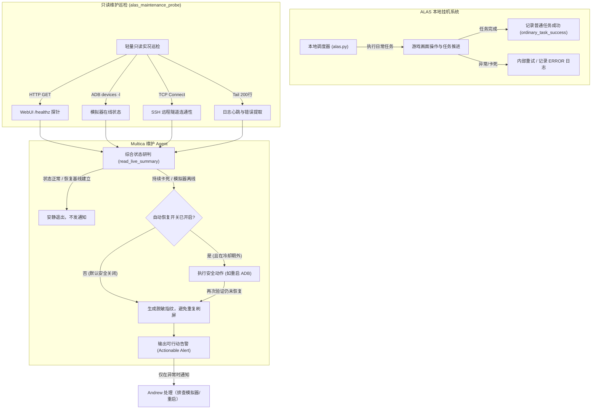

# ALAS AI 游戏维护架构与 Multica Agent 协作分工说明

> 创建日期：2026-10-24 ｜ 最后更新：2026-10-24 ｜ 版本：1.0 ｜ 关联工单：PX-1254

## 1. 背景与核心定位

碧蓝航线自动化脚本（ALAS / AzurPilot）的核心目标是在保障账号安全与稳定性的前提下，尽量少占用本地计算资源与 Andrew 的注意力。

**核心原则：日常操作由本地确定性脚本执行，AI 专职负责异常状态的巡检、告警与安全自愈。**
- 不把日常游戏点击与界面导航改写为大模型操作（高成本、高延迟、低可靠性）。
- ALAS 内部依靠规则和计算机视觉维持高频闭环；Multica Agent 在外部负责低频健康巡检与异常收敛。
- 平时完全安静，只有在模拟器掉线、连续恢复失败或任务确定性卡死时，才向 Andrew 发送包含确切证据与明确操作步骤的可行动告警。

## 2. 三方职责分工矩阵

| 维度 | ALAS 本地执行内核 (AzurPilot) | Multica 游戏维护 Agent | Andrew (人类决策者) |
|---|---|---|---|
| **角色** | 本地执行器 (Executor) | 自动化运维观察员 (Operator) | 最终负责人 (Owner) |
| **核心职责** | 运行日常调度、图像识别、游戏点击、任务内异常重试与日志落盘 | 周期性只读巡检、跨周期异常归集、评估受控自愈、生成结构化告警 | 接收可行动告警、处理高特权物理故障与账号变更 |
| **运行频率** | 持续运行或计划触发（秒级循环） | 定期（如每 5~15 分钟）轻量巡检或由事件唤醒 | 仅在收到告警时介入（极低频） |
| **设备与网络** | 直接连接 ADB 与模拟器，驱动游戏客户端 | 只读探测 WebUI/API/ADB/SSH 通道，不直连游戏内容 | 操作电脑硬件、模拟器窗口、网络环境与路由器 |
| **自愈权限** | 执行任务内的本地刷新与返回主界面重试 | 有限动作（重启 ADB / 重启实例），严格受开关与冷却门禁限制 | 模拟器硬杀重开、更新模拟器、修改 Windows 清单与驱动 |
| **配置与凭据** | 读写实例任务参数、维护执行队列 | 严禁修改游戏账号凭据、不擅自开启高危消耗功能 | 拥有账号密码、Token 秘钥、云服务器与隧道主权限 |

## 3. 协作架构与状态流转



## 4. 真实状态接线与判定规则

维护探针通过 `dev_tools/alas_maintenance_probe.py` 统筹四条只读通道：

1. **WebUI / API 探针**：
   - 目标：`GET http://127.0.0.1:25548/healthz`
   - 判定：HTTP 200 即为健康；连接拒绝或超时判定为 WebUI 服务未运行或主事件循环死锁。
2. **ADB 与模拟器探针**：
   - 目标：执行 `adb devices -l` 只读获取当前设备列表。
   - 判定：目标序列号（如 `127.0.0.1:16448`）状态为 `device` 判定为在线；若为 `offline`、`unauthorized` 或无设备，判定为模拟器断连。
3. **SSH 远程通道探针**：
   - 目标：读取 `config/deploy.yaml` 中的 `RemoteAccess` 配置，对 `SSHServer`（如 `remote.nanoda.work:1022`）进行轻量非阻塞 TCP 连接测试。
   - 判定：端口可连通且配置有效即为通道正常；不向通道发送任何凭据或指令。
4. **日志心跳与业务成功基线**：
   - 目标：只读分析当日日志尾部。
   - 心跳：以最新一条标准格式日志的时间戳为基准，计算相对于本地时间的流逝秒数。超过 `threshold_seconds`（默认 300 秒）未更新且实例应在运行，判定为心跳停滞。
   - 成功判定：只有非 `Restart` 的普通任务出现显式成功信号且携带新 `success_id` 时才确认业务恢复，首个成功事件仅建立基线，显式错误优先于成功标记。

## 5. 有限自动恢复设计与安全防御

自动恢复机制专为应对临时性 ADB 假死或单任务死锁设计，但本票严格要求：**动作仅做规范化设计，默认关闭开关，不默认启用。**

### 动作范围限制
- `restart_adb`：仅执行 ADB 服务重启（`adb kill-server && adb start-server`），尝试重新拉起与模拟器的连接。
- `restart_instance`：通过 ALAS 运行时调度器接口重新拉起调度循环，避免单一任务卡死阻塞后续队列。
- **严禁擅自执行**：严禁自动重启操作系统、严禁强制重装应用、严禁修改游戏配置、严禁执行非白名单指令。

### 防御机制与门禁
1. **总开关默认关闭**：`AutoRecoveryConfig(auto_recovery_enabled=False)`，在干运行（dry-run）模式下只输出建议动作与原因，不产生任何真实调用。
2. **冷却时间限制**：两次恢复动作之间必须间隔至少 `cooldown_seconds`（默认 600 秒），防止反复重启加剧故障。
3. **重试上限限制**：同一故障周期（Episode）内最多允许尝试 `max_attempts`（默认 2 次）。超过 2 次直接标记失败并升级为人工告警。

## 6. 可行动告警标准与示例

告警必须自成一体，严禁仅输出无上下文的「出错了」或原始报错堆栈。每条告警必须清晰包含：
1. **现象描述**：具体是模拟器断开、心跳超时还是任务卡死，附带当前任务与关键报错。
2. **发生时间与持续时长**：让 Andrew 明确知道故障已持续多久，而非历史偶发告警。
3. **脱敏指纹**：基于实例、状态与错误归一化哈希的 16 位指纹，确保同一故障周期内不重复刷屏。
4. **具体人工排查步骤**：编号列出 2~3 个具体动作，明确指出应该看哪里、点什么或运行什么。

### 示例告警卡片

```markdown
### ⚠️ [CRITICAL 告警] ALAS 实例 alas 运行受阻

- **告警编号**：`ALERT-62c14666`（指纹: `62c146664b5dee67`）
- **严重级别**：`CRITICAL`
- **发生时间**：`2026-10-24T12:45:00Z`（持续约 360 秒）
- **异常现象**：模拟器连接中断/掉线：ADB 状态为 `offline`（目标序列号: `127.0.0.1:16448`），未能检测到在线设备。

#### 🛠️ 建议人工动作（请 Andrew 按序排查）：
1. 检查 MuMu 等模拟器窗口是否冻结或已崩溃退出；若已退出请手动重新启动模拟器。
2. 在终端运行 `adb connect 127.0.0.1:16448` 或通过托盘重新连接模拟器。
3. 打开 ALAS WebUI (http://127.0.0.1:25548) 检查实例当前任务与错误日志。

#### 🛡️ 自动自愈状态：
- **自愈开关**：`auto_recovery_enabled=False`（默认安全关闭）
- **自愈评估**：建议动作 `restart_adb`，处理结果：自动恢复开关处于默认关闭状态 (auto_recovery_enabled=False)，未执行任何物理变更操作。
```
